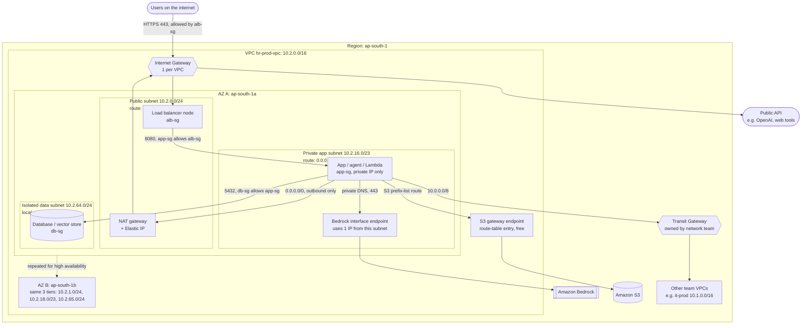

# AWS Networking for GenAI Engineers: VPCs, Subnets, and IP Planning

You are **not** a network engineer. You don't need to design a company's whole network. You **do** need to deploy a RAG app, an agent, or a Lambda into a VPC, and you need to fix it yourself when it times out calling Bedrock.

This guide builds one example from scratch: an application in `ap-south-1` with a public entry point, private application servers, and enough IP addresses to scale. It focuses on **IPv4**.

## How much do you need to know?

| Level | What it means | Topics |
|---|---|---|
| 🟢 **Must know well** | You can explain it, configure it, and fix it without help | IPs and CIDR sizing, subnets (public/private), route tables, NAT gateway, VPC endpoints, security groups, troubleshooting (sections 1–8) |
| 🟡 **Working knowledge** | You understand it and can talk to the platform team about it | Regions and AZs, Internet Gateway, account-per-team setup, company IP plan, Transit Gateway / peering (section 9) |
| ⚪ **Awareness only** | Know the name and what it does in one line | NACLs, TGW route tables, VPN / Direct Connect, Shared VPC, Route 53 Resolver, IPv6 (section 10) |

**Rule of thumb:** know enough to **deploy a private GenAI app, give it a private path to Bedrock and S3, size it for peak load, and debug a timeout**.

## The big picture: everything in one VPC

This diagram shows every piece a GenAI engineer needs to know and how traffic moves between them. AZ B repeats AZ A's layout and is collapsed to keep the diagram readable.



**How to read it:**

| Path in the diagram | What it shows | Section |
|---|---|---|
| User → IGW → load balancer → app → DB | **Inbound** traffic; only the load balancer is public | 3, 4, 7 |
| App → NAT → IGW → public API | **Outbound only**; the app has no public IP | 3, 4, 6 |
| App → Bedrock endpoint → Bedrock | Private path to Bedrock with **no NAT**; the endpoint uses an IP in the app subnet | 6 |
| App → S3 gateway endpoint → S3 | **Free** private path to S3 through the route table | 6 |
| App → Transit Gateway → other VPCs | Calling another team's VPC; this only works because CIDRs **don't overlap** | 9 |
| Port labels (443 / 8080 / 5432) | **Security group** chain; each layer accepts traffic only from the layer in front | 7 |
| Subnet CIDRs (`/24`, `/23`) | Sized for **peak** IP demand; app subnets are the largest | 2, 5 |
| AZ B | The same layout repeated for high availability | 1, 9 |

Route tables used in the diagram:

| Subnet tier | `10.2.0.0/16` | `0.0.0.0/0` | Other routes |
|---|---|---|---|
| Public | `local` | Internet Gateway | — |
| Private app | `local` | NAT gateway in the same AZ | S3 prefix list → gateway endpoint; `10.0.0.0/8` → Transit Gateway |
| Isolated data | `local` | — (none) | — |

## 1. What is a VPC?

A **Virtual Private Cloud (VPC)** is a logically isolated network that you define inside AWS. You choose its IP address range, divide that range into subnets, and configure how traffic moves between resources and outside the network.

A VPC belongs to **one AWS Region** and can span multiple **Availability Zones (AZs)** in that Region. A subnet belongs to **exactly one AZ**. If you want the application to run in two AZs, create an application subnet in each.

### Public cloud, private cloud, and VPC are not the same thing

| Term | What it means |
|---|---|
| **Public cloud** | A provider such as AWS offers cloud services to many customers. The provider runs the underlying infrastructure. Your resources do **not** have to be accessible from the internet. |
| **Private cloud** | A cloud environment dedicated to one organization. It can run on premises or be hosted by a provider. |
| **VPC** | Your logically isolated network inside the public cloud. A VPC can contain both internet-facing and internal resources; it is not the same as a dedicated private cloud. |

In this example, users reach a public load balancer, but the application and database have no public IPv4 addresses.

```text
Internet users
      |
      v
Internet gateway (attached to the VPC)
      |
      v
Public subnets:   internet-facing load balancer
      |
      v
Private subnets:  application servers or workers
      |
      v
Isolated subnets: database or vector store
```

## 2. IP addresses and CIDR blocks

An **IP address** identifies a network interface for communication. A resource can have more than one network interface or IP address. For example, an application task might use private IP `10.2.16.25` to talk to a database at `10.2.64.10`.

- A **private IPv4 address** is used inside a private network or between connected private networks. It is not directly routable on the public internet.
- A **public IPv4 address** can be routed over the internet. Having one does not override route tables or firewall rules.

**CIDR notation** describes a block of addresses. For example, `10.2.16.0/24` covers `10.2.16.0` through `10.2.16.255`. IPv4 has 32 bits; `/24` fixes the first 24 bits and leaves 8, so the block contains `2^8 = 256` addresses. **A smaller prefix number means a larger block.**

| CIDR prefix | Total addresses | Usable in a standard AWS subnet |
|---|---:|---:|
| `/28` | 16 | 11 |
| `/26` | 64 | 59 |
| `/24` | 256 | 251 |
| `/23` | 512 | 507 |
| `/22` | 1,024 | 1,019 |
| `/20` | 4,096 | 4,091 |
| `/16` | 65,536 | 65,531 |

**Subnet capacity = `2^(32 - prefix) - 5`.** AWS reserves the first four and the last address in each standard IPv4 subnet. A VPC CIDR is an address pool, not one big subnet: subtract the five reserved addresses separately for **each subnet** you create.

## 3. What makes a subnet public or private?

A **subnet** is a slice of the VPC address range. What makes an IPv4 subnet public or private is its **route table**, not its name or the numbers in its CIDR.

| Subnet type | Example IPv4 routes | Typical resources |
|---|---|---|
| **Public** | VPC-local route plus `0.0.0.0/0` pointing directly to an internet gateway | Internet-facing load balancer, public NAT gateway |
| **Private with outbound internet** | VPC-local route plus `0.0.0.0/0` pointing to a NAT gateway, not an internet gateway | App servers or workers that call public APIs |
| **Isolated** | VPC-local route, with no route to the internet | Database or vector store that only needs internal connectivity |

A public subnet does **not** automatically make every resource reachable. For an EC2 instance to communicate directly with the IPv4 internet through an internet gateway, it needs a public IPv4 address and the appropriate route and security rules. An internet-facing load balancer can forward traffic to targets that have only private IPs.

### Internet gateway vs. public NAT gateway

An **internet gateway (IGW)** attaches to a VPC and provides a path between eligible resources and the internet. A public subnet points its default route to the IGW. It supports inbound and outbound communication when addressing and security rules allow it.

A **public NAT gateway** lets private resources start connections to the internet **without giving those resources public IPs**. In the zonal setup shown here, the NAT gateway sits in a public subnet and uses an Elastic IP for internet traffic. It translates outbound connections and sends replies back to the private resource. It does not let internet clients start connections to the private resource.

```text
Private worker -> NAT gateway in public subnet -> Internet gateway -> Public API
Private worker <- NAT gateway in public subnet <- Internet gateway <- API reply
```

## 4. How routing tables and traffic work

Every subnet uses one route table. Multiple subnets can share a table. Each route pairs a **destination** with a **target** (where traffic goes next). If multiple routes match, AWS uses the **most specific** match.

| Route table | Destination | Target |
|---|---|---|
| Public | `10.2.0.0/16` | `local` (inside the VPC) |
| Public | `0.0.0.0/0` | Internet gateway |
| Private app, AZ A | `10.2.0.0/16` | `local` |
| Private app, AZ A | `0.0.0.0/0` | Public NAT gateway in AZ A, if needed |
| Isolated data | `10.2.0.0/16` | `local` |

`0.0.0.0/0` is the **default route**: it matches any IPv4 destination if no more specific route applies. From the app, a packet to database IP `10.2.64.10` matches both `/16` and `/0`, so the `/16` local route wins. A packet to a public API IP that matches no other route follows the default route to NAT, if configured.

| Traffic type | Example | Path |
|---|---|---|
| **Inbound (ingress)** | A user opens the app over HTTPS | Internet -> IGW -> public load balancer -> private app |
| **Outbound (egress)** | A worker calls a public API | Private app -> public NAT gateway -> IGW -> API |
| **Internal (east-west)** | The app queries its database in another subnet in the same VPC | Private app -> VPC-local route -> database |
| **Private AWS service access** | The app invokes Bedrock or reads from S3 | Bedrock Runtime interface endpoint (via private DNS), or S3 gateway endpoint (via the subnet's route table); neither path needs NAT |

Inbound and outbound are relative to the resource you are looking at. A **route** provides a path; a **security group** controls which connections are allowed. For example, allow HTTPS on the load balancer and allow the app's listener port only from the load balancer's security group. Security groups automatically allow replies to permitted connections. For AWS API calls, **IAM** still determines whether the app can make the requested operation.

## 5. How many IPs do we need, and what do we configure?

### Step 1: Count IP demand per subnet

Count network interfaces at **peak**, not just on an average day. Include ECS tasks on Fargate, EKS pods that use VPC IPs, EC2 interfaces, and any interface endpoints placed in that subnet. Count load balancer nodes, NAT gateways, and databases in **their own subnets**. VPC-attached Lambda uses shared network interfaces, not one IP per invocation.

Plan for rolling deployments (old and new tasks may overlap), future growth, and AZ failover if a surviving AZ must take extra traffic. Use the largest number of resources that can be present **at the same time**.

### Step 2: Choose the smallest CIDR that fits your plan

Suppose one application subnet in each AZ may need the following:

| Demand in one app subnet | IPs |
|---|---:|
| Peak Fargate tasks | 180 |
| Extra tasks during a full deployment overlap | 180 |
| Two interface endpoints in this subnet | 2 |
| Headroom for growth | 50 |
| **Required usable IPs** | **412** |

Add AWS's five reserved addresses: `412 + 5 = 417`. The next power of two is **512**, which is a **`/23`** (`32 - 9 = 23`). A `/24` gives only 251 usable addresses; a `/23` gives 507 and leaves 95 beyond this estimate. **If an AZ failure can push demand above 507, recalculate for that scenario and choose a larger subnet.**

### Step 3: Allocate non-overlapping CIDRs and enter them in AWS

Example VPC: `10.2.0.0/16`. Each subnet below fits inside the VPC, and none overlap. This is an example layout, not a requirement to use a `/16`; select the VPC block based on all planned subnets and future room.

| Subnet role | AZ A CIDR | AZ B CIDR | Route table to associate |
|---|---|---|---|
| Public entry and optional zonal NAT | `10.2.0.0/24` | `10.2.1.0/24` | Public |
| Private application | `10.2.16.0/23` | `10.2.18.0/23` | Private app table for each AZ if using zonal NAT |
| Isolated database or vector store | `10.2.64.0/24` | `10.2.65.0/24` | Isolated data |

Notice that `10.2.16.0/23` spans `10.2.16.0` through `10.2.17.255`. The next `/23` begins at `10.2.18.0`, **not** `10.2.17.0`. Before choosing the VPC CIDR, check that it does not overlap with other VPCs or office networks you plan to connect.

1. In the **VPC console**, choose **Your VPCs -> Create VPC -> VPC only**. Set **IPv4 CIDR** to `10.2.0.0/16`.
2. Under **Subnets -> Create subnet**, select the VPC, choose an AZ, and enter the **IPv4 subnet CIDR block** from the table. Repeat for each subnet. The CIDR determines capacity; you do not enter an IP count directly.
3. Under **Internet gateways**, create and attach an IGW if the design needs public entry or zonal public NAT. Under **Route tables**, create and explicitly associate the tables, then add the matching routes. If using zonal NAT, give each private app table a default route to the public NAT gateway in its own AZ. If the app needs only VPC-local resources and AWS endpoints, omit the NAT default route.
4. Deploy resources into the intended subnets and check each subnet's **Available IPv4 addresses** in the console. You cannot resize an existing subnet's IPv4 CIDR in place; if it fills up, create another subnet with free space and move or redeploy workloads as appropriate. Adding a VPC CIDR does not enlarge existing subnets.

## 6. VPC endpoints and NAT cost

This is where GenAI engineers most often get stuck.

| Endpoint | Services | Cost | How it works |
|---|---|---|---|
| **Gateway** | S3, DynamoDB | Free | Adds a route to the route table |
| **Interface** | Bedrock, Secrets Manager, SQS, SNS, and others | Per hour + per GB | Adds a network interface with an IP in your subnet; private DNS sends traffic to it |

- Add an **S3 gateway endpoint** to every VPC that reads documents or embeddings from S3.
- Add a **Bedrock Runtime interface endpoint** so prompts and responses don't go through NAT.
- Each interface endpoint **uses one IP per AZ**, so include it when sizing subnets.
- The endpoint's security group must allow HTTPS (443) from your app's security group.

**NAT cost trap:** a NAT gateway is billed **per hour and per GB processed**, even when idle. Sending model weights, large documents, or S3 traffic through NAT can cost a lot. Send AWS service traffic through endpoints and use NAT only for the public internet (`pip install`, OpenAI or Anthropic APIs, web tools). AWS also offers a newer **regional** NAT gateway that spans AZs and doesn't need a public subnet.

## 7. Security groups

Build a chain where each layer accepts traffic only from the layer in front of it:

```text
Internet --443--> alb-sg --8080--> app-sg --5432--> db-sg
```

| Security group | Allow inbound | Meaning |
|---|---|---|
| `alb-sg` | 443 from `0.0.0.0/0` | Anyone can reach the site over HTTPS |
| `app-sg` | 8080 from `alb-sg` | Only the load balancer can reach the app |
| `db-sg` | 5432 from `app-sg` | Only the app can reach the database |

- Use a **security group as the source**, not an IP address. Container IPs change all the time.
- Security groups are **stateful**: if a request is allowed, its reply is allowed automatically.
- Remember: **route = a path exists; security group = the connection is allowed; IAM = the API call is allowed**. All three must be in place.

## 8. Troubleshooting a timeout

Learn these checks. They cover most "it just hangs" problems:

| # | Check | Fix |
|---|---|---|
| 1 | Does the target's security group allow my port and source? | Add an inbound rule |
| 2 | Does my subnet's route table have a path to the target? | Add a route to NAT, an endpoint, or a Transit Gateway |
| 3 | For internet access: is there a NAT gateway (private subnet) or an Internet Gateway (public subnet)? | Add the missing gateway |
| 4 | Did the subnet run out of IPs? | Check **Available IPv4 addresses**; use a bigger subnet |

Tool: **VPC Reachability Analyzer** shows which step blocks the path.

> Most common GenAI bug: a Lambda or agent in a private subnet times out calling Bedrock or S3. **Cause:** there is no NAT and no endpoint. **Fix:** add the endpoint, or add a NAT route if the app needs the public internet.

## 9. Working knowledge

| Topic | What you need |
|---|---|
| **Regions and AZs** | A Region contains several AZs. Check that your **Bedrock models are available in the Region** before choosing it. Use 2 or more AZs. Consider data residency. |
| **Internet Gateway** | One per VPC. A resource is reachable from the internet only when it has an IGW route, a public IP, and a security group rule that allows the traffic. In good designs, only the load balancer uses it. AWS charges for every public IPv4 address. |
| **Accounts per team/env** | `hr-dev` and `hr-prod` are separate accounts. A mistake in dev shouldn't affect prod. You will deploy into an account someone else set up. |
| **Company IP plan** | VPC ranges **must not overlap**, or they can't be connected later. **Ask the network team for a CIDR**; don't choose one yourself. |
| **Transit Gateway / peering** | Use them when your app needs to call another team's VPC. A route like `10.0.0.0/8 → TGW` sends that traffic to the hub. The network team owns the hub. For just two VPCs, VPC peering is enough. |

## 10. Awareness only (skip for now)

| Topic | One-line summary |
|---|---|
| Network ACLs | A second, stateless firewall at the subnet level. Security groups are usually enough. |
| TGW route tables | How the network team keeps dev and prod separate. |
| VPN / Direct Connect | Connects the office or data center to AWS. |
| Shared VPC | One VPC whose subnets are shared with many accounts. |
| Route 53 Resolver endpoints | Lets internal DNS names work between the office and AWS. |
| IPv6 | The newer, larger address format. Most GenAI tutorials still use IPv4. |

## 11. GenAI scenarios you should be able to handle

| Scenario | What you configure |
|---|---|
| RAG app on ECS calls Bedrock and reads docs from S3 | Private app subnets + Bedrock Runtime interface endpoint + S3 gateway endpoint + `app-sg` that allows traffic only from `alb-sg` |
| Agent calls the OpenAI API or a public web tool | NAT gateway route in the private route table |
| Lambda in a VPC times out calling Bedrock | Add the Bedrock endpoint or a NAT route. Check that the endpoint security group allows 443 from the Lambda security group. |
| Agent pods on EKS scale from 20 to 500 | Size app subnets for peak pods plus deployment overlap. `/20` is a safe default. |
| NAT bill is high | Move S3 traffic to the free gateway endpoint and Bedrock traffic to an interface endpoint. Don't pull large models through NAT repeatedly. |
| App needs a vector DB in a private data subnet | Put the DB in an isolated subnet with no NAT route. `db-sg` allows the DB port only from `app-sg`. |

## Sources

- AWS documentation: [VPC and subnet sizing](https://docs.aws.amazon.com/vpc/latest/userguide/vpc-subnet-sizing.html), [route tables](https://docs.aws.amazon.com/vpc/latest/userguide/VPC_Route_Tables.html), [NAT gateways](https://docs.aws.amazon.com/vpc/latest/userguide/vpc-nat-gateway.html), and [VPC endpoints (AWS PrivateLink)](https://docs.aws.amazon.com/vpc/latest/privatelink/what-is-privatelink.html).
